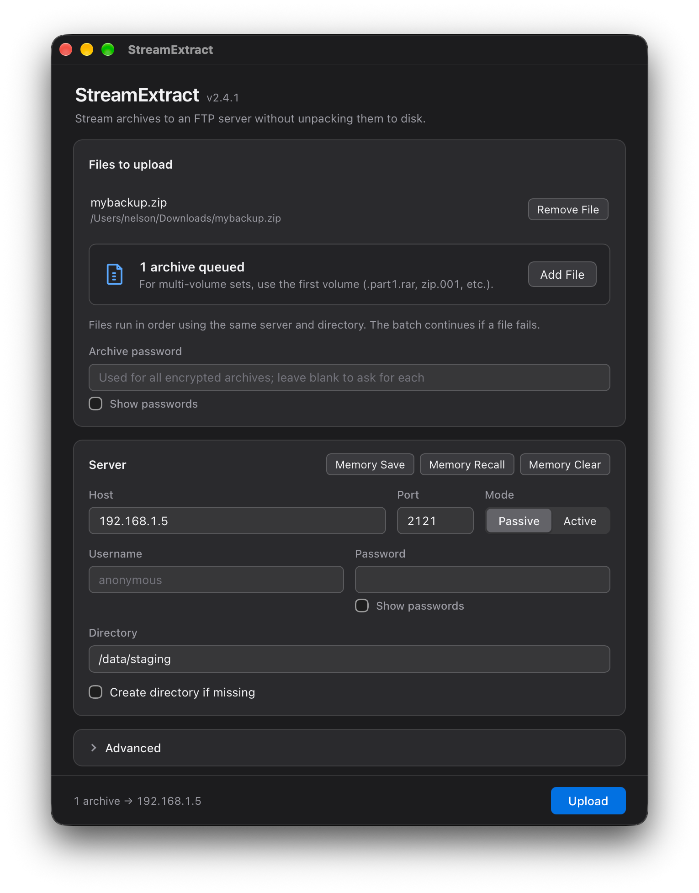
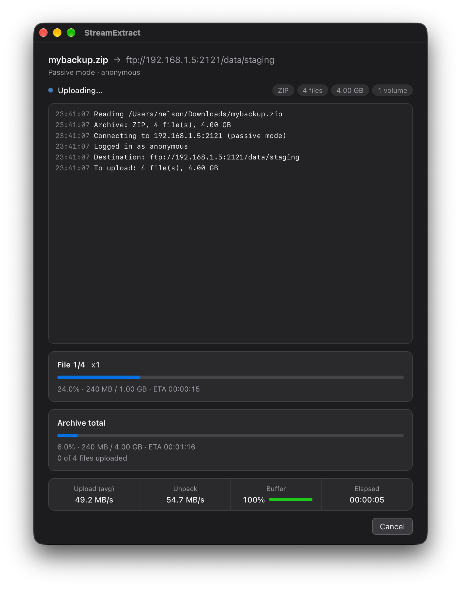

# StreamExtract

Upload files from archives and filesystem images to an FTP, FTPS or SFTP server
**without extracting them to disk**. Decompression and upload run together,
using a memory buffer instead of temporary files.

Available for Windows, macOS and Linux as a desktop app (**StreamExtract**) and
a command-line tool (**sext**).

## Download and install

Download the app or command-line tool from the
[Releases page](https://github.com/RuiNelson/streamextract/releases).
There is no installer. Windows and Linux downloads are RAR archives and need a
RAR5-compatible extractor, such as WinRAR, 7-Zip or `unrar`. macOS downloads are ZIP files.

| Platform | Desktop app | Command line |
|---|---|---|
| Windows 10/11 (x64) | `streamextract-gui-windows-x64.rar` | `streamextract-cli-windows-x64.rar` |
| macOS 12+ (Intel and Apple Silicon) | `streamextract-gui-macos-universal.zip` | `streamextract-cli-macos-universal.zip` |
| Linux (x64, glibc 2.35+) | `streamextract-gui-linux-x64.rar` | `streamextract-cli-linux-x64.rar` |
| Linux (arm64, glibc 2.35+) | `streamextract-gui-linux-arm64.rar` | `streamextract-cli-linux-arm64.rar` |

- **Windows**: extract the app and run `StreamExtract.exe`, keeping
  `streamextractcore.dll` beside it. The app requires WebView2. The executable is
  unsigned, so SmartScreen may show a warning on first launch.
- **macOS**: extract the app and move `StreamExtract.app` to `/Applications`.
  Release builds are signed and notarized.
- **Linux**: extract the app, make it executable with
  `chmod +x StreamExtract.AppImage`, then run `./StreamExtract.AppImage`.
  It requires FUSE 2 (for example, the `libfuse2` package).

For the command-line tool, extract `sext` (`sext.exe` on Windows) and run it from
a terminal. You can place it in a directory in your `PATH` to call it from
anywhere. Run `sext --help` to see the available options.

## Desktop app

<table>
<tr>
<td></td>
<td></td>
</tr>
</table>

1. Drop an archive or image onto the window, or add it with **+**. For split
   archives, select the first volume.
2. Choose the **Protocol** and enter the server address, login details and
   **Destination directory**. Enable **Create directory if missing** if needed.
3. Click **Upload**. The app shows progress, speeds, estimated time remaining
   and a log, followed by a summary.

You can queue several archives. They upload in order to the same destination;
if one fails, the others still run. Each archive's **…** menu lets you set its
password, select an **Extraction Root**, reorder it or remove it. If an encrypted
archive needs a password, the app asks for one.

**Memory Save**, **Memory Recall** and **Memory Clear** manage saved server
configurations. Credentials are saved in plain text only with your consent;
archive passwords are never saved. **Advanced** contains the memory buffer,
upload attempts, display units, verbose logging and FTPMC settings. These
preferences are remembered automatically.

For SFTP key authentication and host verification, open **SSH settings**.
An optional **Staging directory** lets you upload files before moving them to
the destination; see [Transfer behaviour](#transfer-behaviour).

**Cancel batch** stops the current transfer and prevents the remaining archives
from starting. The incomplete remote file is removed; completed files remain.

## Supported inputs

Formats are detected from the file contents, regardless of the extension.

| Format | Support |
|---|---|
| **RAR** | RAR 5.x and older, multi-volume and solid archives, password protection and encrypted file names. |
| **ZIP** | Stored, Deflate, BZip2, LZMA, XZ, Zstandard and PPMd; Zip64; ZipCrypto and AES encryption; numbered split parts (`.zip.001`). |
| **7z** | LZMA, LZMA2, PPMd, BZip2, Deflate and Zstandard with filters; solid archives; AES-256 encryption, including file names; numbered split parts (`.7z.001`). |
| **tar** | Plain or compressed with gzip, bzip2, xz, lzma, Zstandard or LZ4; numbered split parts. |
| **exFAT** | Raw volume images (`.exfat`), including fragmented files and files over 4 GiB. |
| **PlayStation PFS/PFSC** | Unsigned PS4/PS5 MkPFS images (`.ffpfsc`, `.ffpfs`, `.pfs`) with 32-bit contiguous inodes, raw or PFSC-compressed. A single wrapped exFAT, UFS or PFS image is opened automatically. |
| **UFS1 / UFS2** | Raw volumes (`.ufs`, `.ffpkg`), including sparse files and images wrapped in PFS/PFSC. |

Keep all split archive parts together and select the first one, such as
`.part1.rar`, `.zip.001` or `.7z.001`. Filesystem images must contain a single raw
volume without a partition table; split images and signed or encrypted PFS
images are unsupported.

Other limits:

- ZIP and 7z entries using Deflate64 are unsupported.
- Old-style spanned ZIP sets (`.z01`, `.z02`, …) are unsupported.
- Standalone compressed files such as `file.gz` are unsupported; compressed tar
  archives such as `files.tar.gz` are supported.
- Symbolic links, hard links and file references are skipped with a warning.
- Tar, exFAT, unsigned PFS and UFS have no complete file-data checksum. Uploads
  from these formats include a verification warning.

## Connections

| Protocol | Default port | CLI selection |
|---|---|---|
| **FTP** | 21 | `--protocol ftp` (default) |
| **FTPS (explicit)** | 21 | `--protocol ftps` |
| **FTPS (implicit)** | 990 | `--protocol ftps --ftps-mode implicit` |
| **SFTP** | 22 | `--protocol sftp` |

FTP is unencrypted. Both FTPS modes encrypt the connection and verify the
server certificate and hostname. Use `--cacert` in the CLI for a private CA.
FTP and FTPS use passive mode by default; active mode is also available.

SFTP supports password authentication and RSA, ECDSA or Ed25519 OpenSSH private
keys, including encrypted keys. Host-key verification is optional: configure
**SSH settings** in the app or `--known-hosts` in the CLI. Without that setting,
any host key is accepted. SSH agents, keyboard-interactive authentication and
SSH configuration files are not used.

Two optional FTP/FTPS settings can improve transfer speed on compatible servers:

- **Block mode (MODE B)** keeps data connections open between files, reducing
  overhead for archives with many small files. Enable it in the app's **Server**
  settings or with `--mode-b`.
- **FTPMC** sends each file over several parallel data connections. Enable it
  under **Advanced** or with `--ftp-mc N`. It requires passive mode. [More Information](https://github.com/RuiNelson/FTPMC)

Both are off by default and fall back to a normal connection with a warning if
the server refuses them. Neither applies to SFTP.

## Transfer behaviour

Files already on the server are handled by **name and size**:

| Remote file | Action |
|---|---|
| Same size | Skip it as complete. |
| Smaller | Keep its existing bytes and append the remaining data. |
| Larger | Delete it and upload from the beginning. |
| Missing or size unavailable | Upload from the beginning, replacing any existing file. |

**Existing contents are trusted without comparison.** A file with the right
size is skipped even if its contents differ. Re-running a transfer uses the same
rules to skip completed files and resume partial ones.

Folders, including empty ones, are preserved. An **Extraction Root** uploads
only a selected folder's contents, without that folder's path prefix. For
example, choosing `b` uploads `b/xyz.bin` as `xyz.bin` in the destination.

Connection and upload failures get up to **3 attempts** by default. Change
**Upload attempts** in the app or use `--retries N`; `1` disables retries.
A source error, cancellation or exhausted attempts stops that archive and
removes the incomplete remote file.

### Staging

Set a **Staging directory** (`--staging DIR`) to upload and resume there first.
After the entire archive succeeds, its files move to the destination, replacing
matching destination files. Unrelated files are kept. Leave staging empty to
upload directly to the destination.

An existing staging copy takes priority for skip and resume checks. If there
is no staging copy, a destination file of the expected size is skipped.
The staging directory must differ from the destination and cannot contain it.
The server must support renaming between the two locations, normally on the
same filesystem.

If moving files fails or is cancelled, files already moved stay in the
destination and the rest stay in staging. Re-run the transfer to continue.

## Command line

Upload an archive over FTP:

```bash
sext --file archive.rar --host ftp.example.com \
     --user username --directory /uploads --mkdir
```

The command prompts for the FTP login password. Add `--protocol ftps` for
explicit FTPS, or use SFTP with a private key:

```bash
sext --file backup.zip --host example.com --protocol sftp \
     --private-key ~/.ssh/id_ed25519 --known-hosts "" --directory /uploads
```

The full-screen interface shows progress, speeds and estimated time remaining.
Use `--no-tui` for plain log output; this is automatic outside a terminal.
Cancel with `q`, `Esc` or `Ctrl-C`.

| Option | Description |
|---|---|
| `--file PATH` | Archive or filesystem image; first volume for a split archive. Required. |
| `--host HOST` | Server name or IP address, without a URL scheme or path. Required. |
| `--protocol ftp\|ftps\|sftp` | Transfer protocol. Default: `ftp`. |
| `--ftps-mode explicit\|implicit` | FTPS mode. Default: `explicit`. Requires `--protocol ftps`. |
| `--port PORT` | Override the protocol's default port. |
| `--user NAME` | Login name. Default: anonymous for FTP/FTPS, local username for SFTP. |
| `--password PASSWORD` | Login password. FTP/FTPS requires `--user` and prompts if omitted; SFTP never prompts. |
| `--directory DIR` | Destination, absolute or relative to the login directory. Default: login directory. |
| `--mkdir` | Create missing destination and staging directories; their parents must exist. |
| `--staging DIR` | Upload here, then move files to the destination after the archive succeeds. |
| `--archive-password PASSWORD` | Archive password; prompted for when needed. |
| `--extraction-root DIR` | Upload only this archive folder's contents. Use a relative path such as `b/c`, without a leading `/`; omit for the whole archive. |
| `--private-key PATH` | SFTP private key. Without a password or selected key, keys in `~/.ssh` are tried. |
| `--private-key-passphrase PASSPHRASE` | Encrypted SFTP key passphrase, separate from the login password; never prompted. |
| `--known-hosts PATH` | SFTP host-key verification file. `""` uses `~/.ssh/known_hosts`; omitted accepts any host key. |
| `--cacert PATH` | PEM CA certificate file for FTPS. |
| `--mode passive\|active` | FTP/FTPS connection mode. Default: `passive`. |
| `--mode-b` | Enable FTP/FTPS block mode. |
| `--ftp-mc N` | Parallel passive FTP/FTPS data connections per file: 1–64; `0` disables (default). |
| `--ftp-mc-stripe BYTES` | FTPMC stripe size; `0` uses the server default. Maximum: 4294967295, or 2147483647 on Windows. |
| `--buffer MIB` | Memory buffer in MiB: 1–4096. Default: `64`. |
| `--retries N` | Total connection/login and per-file upload attempts. Default: `3`. |
| `--no-tui` | Plain log output. |
| `--verbose` | Detailed connection and protocol logging; credentials are masked. |
| `--help` / `--version` | Show options or version. |

Exit codes: `0` success, `1` error, `2` invalid command line, `130` cancelled.

## Building from source

See the [build and test guide](https://github.com/RuiNelson/streamextract/blob/main/docs/building.md)
for dependencies, compilation and tests.

## License

StreamExtract is licensed under [MIT](LICENSE). Bundled libraries have their
own terms; see [THIRD_PARTY_NOTICES.md](THIRD_PARTY_NOTICES.md), including the
UnRAR restriction against recreating the RAR compression algorithm.
